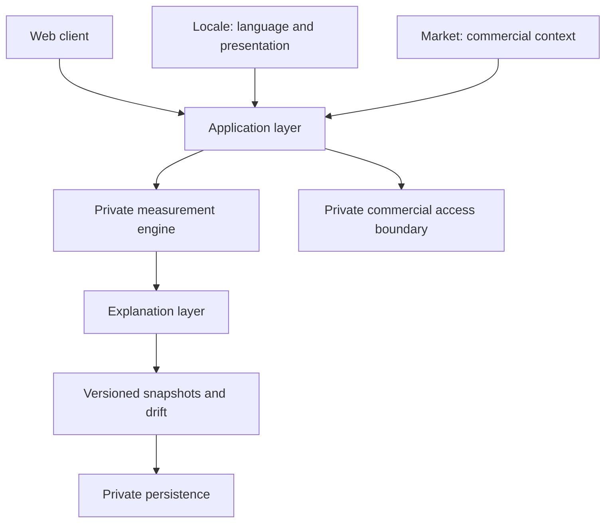

# TypeSignal

A multilingual personality measurement product designed to explain why repeated assessments can move between neighboring personality types instead of hiding that uncertainty behind a single categorical label.

[Live Product](https://typesignal.app) · [Architecture](docs/architecture.md) · [Measurement Design](docs/measurement-design.md) · [日本語](README.ja.md) · [中文](README.zh-CN.md)

**This repository is a sanitized engineering and product case study for recruiting. It is not the production application's source distribution.** The shipped product and its commercial implementation remain separate and private.

## The problem

`INTP → INTJ → INTP`

A person can receive neighboring labels across repeated assessments without learning what moved underneath. A categorical result alone does not show a narrow margin, a changed response context, or an incompatible comparison between different questionnaires.

TypeSignal was designed to make these distinctions visible: dimensional tendencies, nearby candidates, explanations tied to the current result, and comparisons with earlier snapshots. It is a self-reflection product, not a clinical assessment or an official MBTI instrument. [Product problem and design decisions →](docs/product-problem.md)

## What this repository demonstrates

| Design decision | Evidence you can inspect here |
| --- | --- |
| Preserve the profile behind a label | [Reduced measurement and snapshot interfaces](src/model.ts) |
| Explain change without asserting its cause | [Synthetic explanation implementation](src/explanation.ts) |
| Reject misleading comparisons | [Validation](src/validation.ts), [comparison](src/comparison.ts), and counterexample tests |
| Separate language from commercial context | [Locale / market types and guards](src/context.ts) |
| Deliver a commercial product with explicit boundaries | [System architecture](docs/architecture.md), [sanitization policy](docs/sanitization.md), and the live product |

For a **10-minute review**: read this page, run `npm run demo`, inspect the comparison and its tests, then read the architecture and internationalization notes.

## System architecture

The diagram describes the shipped product at a conceptual level. Most nodes are intentionally **not implemented in this public repository**.



The production stack combines Next.js, React, TypeScript, PostgreSQL/Supabase, Stripe and Vercel. The public examples use only TypeScript and Node's test runner: **no production database, authentication, network service or payment dependency is required**.

## Measurement, explanation and drift

The interface separates measurement output from presentation. A four-letter label is one field; it is not the complete profile. Nearby candidates and boundary strength belong to the private interpretation layer. This repository does not compute them or expose the thresholds that do.

The runnable example uses **hand-authored fictional values and supplied labels**. On this illustrative scale, larger scores point toward the second letter of each axis; scores are not probabilities.

| Snapshot | Supplied label | E–I | S–N | T–F | J–P |
| --- | --- | ---: | ---: | ---: | ---: |
| T1 | INTP | 65 | 68 | 32 | 54 |
| T2 | INTJ | 66 | 67 | 32 | 48 |
| T3 | INTP | 65 | 68 | 32 | 53 |

Between T1 and T2, the J–P value moves 6 points toward J, while S–N moves 1 point toward S and T–F does not move. The supplied label also changes. The example reports both facts; **it does not calculate the label, establish why the responses changed, or classify the change as psychologically meaningful**.

The examples also test the reverse case: a label can stay the same while its underlying values move. Model, questionnaire, schema and language compatibility are explicit preconditions for this conservative demonstration. A valid market change alone does not invalidate comparison.

[Measurement design](docs/measurement-design.md) · [Explainability](docs/explainability.md) · [Drift](docs/drift.md)

## Internationalization and market architecture

`locale ≠ market ≠ deployment`

- **Locales:** `ja`, `zh-Hans`, `zh-Hant`, `en` — presentation and question language.
- **Markets:** `JP`, `TW`, `HK`, `GLOBAL_ZH`, `GLOBAL_EN` — commercial and regional context.
- **Deployment:** infrastructure context, not an implicit language or pricing decision.

A Traditional Chinese interface does not automatically imply Taiwan, and Japanese text does not require a Japan purchase context. Public types preserve those independent choices; actual prices, routing and market policies are excluded. [Why this matters →](docs/internationalization.md)

## Commercial product boundary

The shipped product includes assessment, result, entitlement and commercial-access flows. Checkout, signed webhook processing and reconciliation belong to that production architecture.

**Commercial infrastructure exists in the production system but is intentionally excluded from this public showcase.** No payment handler, entitlement mutation, refund implementation, claim flow, production schema or configuration is published. Public tests do not claim to verify live transactions.

## Run the selected implementation

Requires Node.js 24 and npm. After dependency installation, examples run offline. There are no environment variables to configure.

```sh
npm ci --ignore-scripts
npm run verify
npm run demo
npm run check:history
```

`verify` runs strict typechecking, lint, build, executable tests, the public-content scan and local Markdown link checks. `check:history` additionally checks every available Git object and author identity. Dependency advisories are checked separately by `npm audit --audit-level=moderate` and CI.

## Selected source and evaluation

Two small excerpts preserve real engineering choices: locale/market guards are reduced from the shipped product, and the local recovery-ID helper is retained with its explicit **non-authentication** warning. Other domain models, validators, comparison code, narration and fixtures were written specifically for this showcase. [File provenance and boundaries →](docs/sanitization.md)

Tests cover invalid/non-finite scores, dates, incompatible versions and languages, independent markets, supplied labels, delta narration and omission of unexpected fields. These are software-contract checks, **not psychometric validation**. No claim of clinical validity, population statistics, customer volume or commercial results is made by these fixtures.

```text
src/          small domain, validation, comparison and explanation examples
examples/     fictional T1 / T2 / T3 profiles and runnable demonstration
tests/        deterministic contract and counterexample tests
scripts/      publication, history and documentation checks
docs/         product and architecture case study
.github/      CI with read-only permissions and pinned actions
```

## Intentionally excluded

Full question wording, question-to-score mappings, weights, calibration, thresholds, adjacent-type rules, production explanation/drift algorithms, payment/identity/authorization implementations, database policies, abuse controls, private analytics, operational history, prompts, credentials and user records remain private.

Security-safe is not automatically business-safe. The export is an explicit selection, not a credential-stripped copy of the product. See [SECURITY.md](SECURITY.md).

## About the production product

[TypeSignal](https://typesignal.app) is the actual shipped product. This repository is a compact reviewable case study, with no parallel hosted clone and no connection to the production backend. The code examples are available for technical review; no open-source license is currently specified.
