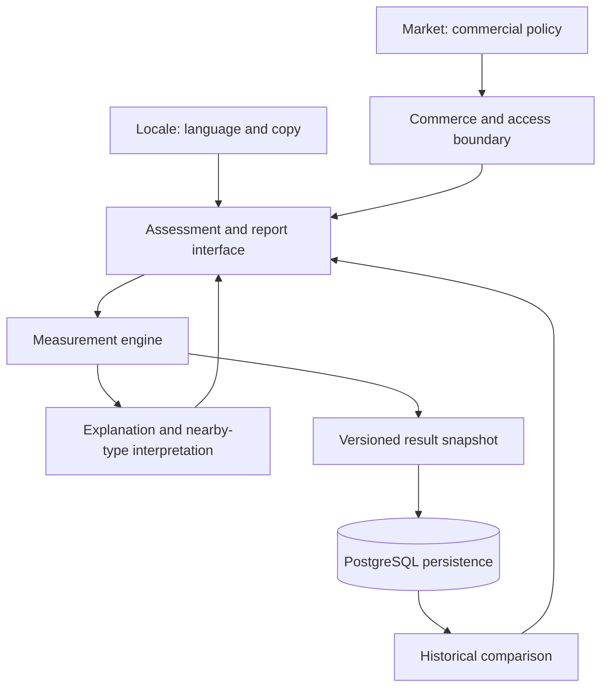

# Architecture and publication boundary

TypeSignal is a commercial web product built with Next.js, React, TypeScript, and PostgreSQL, hosted on Vercel. This repository is a sanitized recruiting case study, not a product clone or an open-source release of the production application.

The diagram describes the **product architecture**, not an executable system included here:

Separating these responsibilities keeps copy changes and commercial availability from silently changing measurement rules. Locale remains explicit context. Versioned snapshots help determine whether two records can be compared, rather than treating every saved result as interchangeable.

**Implemented here:** typed context, an interface-only measurement boundary, snapshot validation, synthetic comparison arithmetic, and a local recovery ID helper. The examples make no network requests and do not persist customer records. Commerce, database integration, scoring, and the full interpretation engine are excluded.

Start with [measurement design](measurement-design.md), then [historical comparison](drift.md). These smaller examples expose engineering decisions without publishing the commercial implementation.
